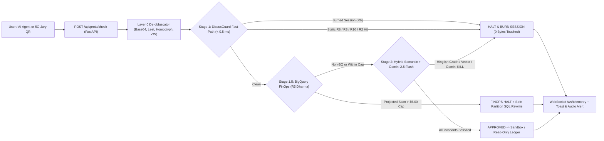
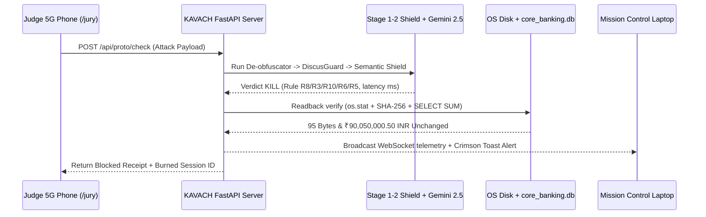
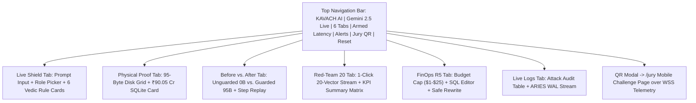
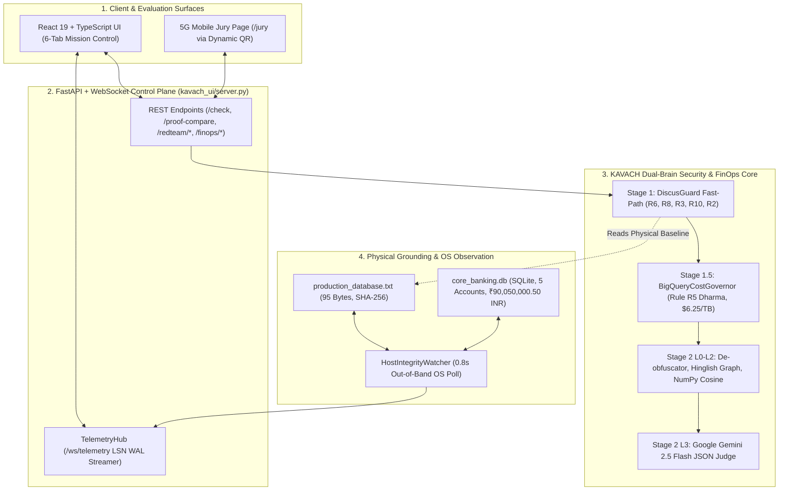
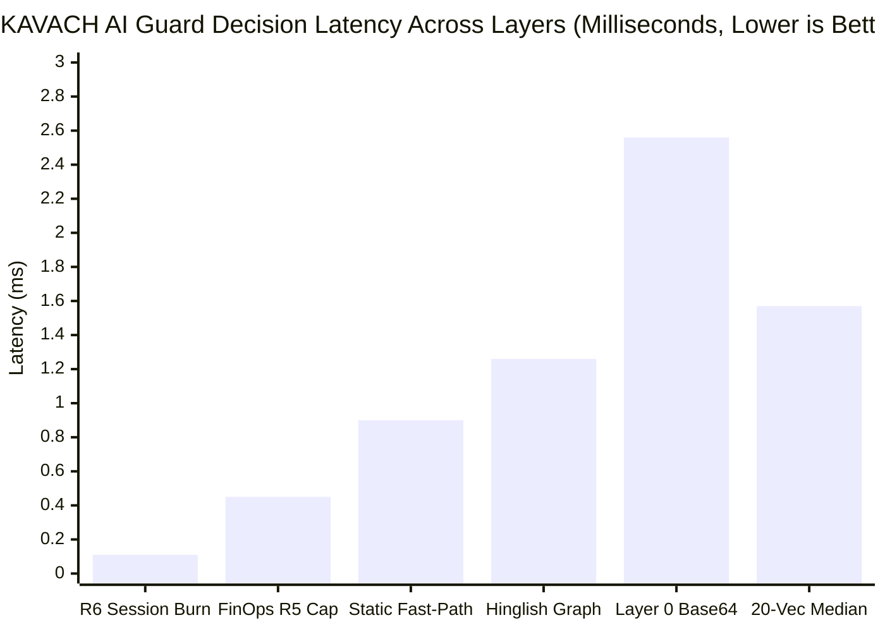

# KAVACH AI — Official Pitch Deck Complete Copy, Mermaid Diagrams & Corporate Visual Prompts

> **Source Template Inspected:** [Final Prototype Submission Deck _ Startup Buildathon.pptx](file:///E:/KAVACH-AI/docs/plan/Final%20Prototype%20Submission%20Deck%20_%20Startup%20Buildathon.pptx) (`16:9` widescreen, `16` template slides)  
> **Target Output Deliverable:** Deliverable 02 — Final Submission **PDF (`< 10 MB`)**  
> **Event:** Google DeepMind × Google Cloud Startup Buildathon India 2026 (Bengaluru) · Track: Open Innovation  
> **Live Public Prototype Link (Deliverable 01):** `https://kavach-ai-tq4t.onrender.com`  
> **GitHub Repository:** `https://github.com/Roy12233444/kavach-ai`  
> **Visual Design Standard:** Clean White Corporate / Google Cloud Executive Aesthetic *(Zero dark sci-fi artwork; crisp vector diagrams, high-contrast typography, verified live screenshots only)*

---

## 0. Template Housekeeping & PDF Export Checklist (`Read First`)

Before adding content inside PowerPoint / Google Slides:

1. **DELETE Template Slide 1** *(Download instructions helper screenshot `image1.png` — not for judges).*
2. **KEEP Official Template Backgrounds Intact:**
   - **Template Slide 2 (`image3.png`):** Official Cover Slide with Google DeepMind | Google Cloud | Startup Buildathon banner.
   - **Template Slides 3–13 (`image2.png`):** Official Clean White Content Slides with top Google DeepMind / Google Cloud / H2S / nasscom / HEADSTART header strip *(keep top `1.1 inches` clear so nothing overlaps the logos!)*.
   - **Template Slide 16 (`image4.png`):** Official closing **"Thank you"** slide.
3. **DELETE Empty Template Slides 14 & 15** *(unless using Slide 14 for extra full-size prototype screenshots — never leave empty slides).*
4. **Typography & Palette (Matches Template):**
   - **Fonts:** `Google Sans` / `Inter` / `Segoe UI` (Body `13–15 pt`, Card Headings `15–16 pt Bold`, Slide Title `22–26 pt Bold`) + `JetBrains Mono` / `Consolas` for latency metrics & SQL snippets.
   - **Colors:** Primary `#1A73E8` (Google Blue), Dark Text `#0F172A` (Slate 900), Muted Text `#475569` (Slate 600), Safe Accent `#16A34A` (Emerald), Alert Accent `#DC2626` (Crimson), Card Border `#E2E8F0` on `#FFFFFF` / `#F8FAFC`.
5. **Final PDF Gate:** Export via **File → Save As / Download as PDF (`Standard`)** and verify file size is strictly **`< 10 MB`** before uploading on Hack2skill.

---

## Slide 2 (Official Cover Slide) — Team & Problem Statement

> **Template Prompts on Slide:** `Team Name:` · `Team Size:` · `Problem Statement:`  
> *(Preserve `image3.png` top banner completely clear; place content cleanly in the lower white region.)*

### Ready-to-Paste Slide Copy

**Team Name:** `[Your Registered Hack2skill Team Name — e.g. Nexus LAB AI Systems]`  
**Team Size:** `[Your Registered Team Size — e.g. 1 (Sourav Ray — Founder & Systems Architect)]`  
**Track:** `Open Innovation — Enterprise AI Security & Cloud FinOps`

**Problem Statement:**
> Modern autonomous agents powered by LLMs (such as Google Gemini) reason at superhuman speed, yet **enterprises in banking, healthcare, and cloud operations cannot safely grant probabilistic models direct write access to production filesystems, SQL databases, or billed cloud warehouses**. A single prompt injection, Base64/Hinglish obfuscated bypass, PII exfiltration, or unpartitioned BigQuery `SELECT *` scan can wipe physical assets (`rm -rf` / `DROP TABLE`), leak sovereign Indian PII (Aadhaar/PAN), or trigger runaway cloud billing spikes within milliseconds.

**Live Links Footer:**  
- **Live Prototype:** `https://kavach-ai-tq4t.onrender.com`  
- **Mobile Judge Challenge (`/jury`):** `https://kavach-ai-tq4t.onrender.com/jury`  
- **Source Code:** `https://github.com/Roy12233444/kavach-ai`

---

## Slide 3 — Brief About the Idea

> **Template Title:** `Brief about the idea`

### Ready-to-Paste Slide Copy

**Headline Banner:**  
**KAVACH AI: Deterministic Invariant Armor + Hybrid Semantic & FinOps Shield for Autonomous Agents**

**Core Thesis (Left Column — "The Enterprise Paradox"):**
- Probabilistic LLMs (`Gemini 2.5 Flash`) excel at planning multi-step workflows, **not** at acting as self-policing security boundaries.
- Relying solely on system prompts (`"Do not delete databases"`) fails against obfuscation, multilingual Hinglish attacks, and indirect social engineering.
- Conversely, running an external LLM judge on every request introduces `1,000–2,000 ms` latency spikes and explodes token bills on trivial threats.

**Our Solution (Right Column — "Dual-Brain Constitutional Execution Kernel"):**
1. **Stage 1 — Deterministic Vedic Fast-Path (`DiscusGuard`, `< 0.5 ms` avg):** Intercepts explicit `rm -rf` / `DROP TABLE`, Aadhaar/PAN/API keys, agent role privilege drift, and previously burned sessions (`R6 Varuṇa` in `0.11 ms`) with zero LLM overhead.
2. **Stage 1.5 — BigQuery FinOps Governor (`R5 Dharma`, `< 0.5 ms`):** Halts runaway multi-terabyte `SELECT *` warehouse queries (`$267.50` vs. `$5.00` hard cap) before GCP dispatch and generates partition-pruned safe SQL rewrites (`$0.04`).
3. **Stage 2 — 4-Layer Hybrid Semantic Shield + Live Gemini 2.5 Flash:** Strips Unicode zero-width chars, Cyrillic homoglyphs, leetspeak, and Base64 → resolves Hinglish & typos via an Action-Graph (`~1.2 ms`) → runs a `2048`-dim NumPy vector check → escalates subtle social-engineering phrasing directly to Google **`gemini-2.5-flash`**.

**3 Bottom KPI Callouts:**
- **`20 / 20` Red-Team Attacks Blocked** (`1.57 ms` median decision speed, `0%` bypass)
- **`95 / 95 Bytes` Physical Disk & `₹90.05 Cr` SQLite Preserved** (Zero-mock live verification)
- **`99.99%` BigQuery Scan Cost Reduction** (`$267.50` runaway scan → `$0.04` partitioned rewrite)

---

## Slide 4 — Opportunities

> **Template Prompts on Slide:** `Opportunities` · `How different is it from any of the other existing ideas?` · `How will it be able to solve the problem?` · `USP of the proposed solution`

### Ready-to-Paste Slide Copy (2×2 Structured Card Grid)

#### Card 1 — Market Opportunity
- **Enterprise AI Governance Bottleneck:** Regulated Indian & global enterprises (BFSI/FinTech under **RBI** & **DPDP Act 2023**, Healthcare, Cloud SRE teams) urgently want autonomous Gemini agents in production—blocked only by deterministic execution safety and cloud FinOps predictability.
- KAVACH operates model-agnostically at the **tool/execution boundary** (shell, SQL, BigQuery, filesystem), unlocking high-trust production deployment.

#### Card 2 — How Different Is It From Existing Ideas?
| Approach | Latency | Obfuscation / Hinglish | Stateful Session Burn | Physical + FinOps Proof |
| :--- | :---: | :---: | :---: | :---: |
| **Prompt-Only System Guardrails** | `0 ms` | ❌ Bypassed easily | ❌ None | ❌ None |
| **Pure LLM-as-a-Judge Wrappers** | `1,500+ ms` | ⚠️ Costly per call | ❌ Stateless | ❌ None |
| **KAVACH AI (Dual-Brain Kernel)** | **`1.57 ms` median** | ✅ **Layer 0–3 + Gemini 2.5** | ✅ **`R6 Varuṇa` (`0.11 ms`)** | ✅ **OS Disk + SQLite + `R5` FinOps** |

#### Card 3 — How Will It Solve the Problem?
- Places a **zero-trust pre-execution kernel** directly between agent tool proposals and host OS / database / cloud APIs.
- Enforces **6 formal Vedic Invariants**: Prompt Override (`R8`), Sovereign PII/Secrets (`R3`), Destructive OS/SQL (`R10`), Role Scope (`R2`), Permanent Session Burn (`R6`), and BigQuery FinOps Cost Equilibrium (`R5`).
- Monitors real physical targets continuously (`0.8s` OS file & SQLite `HostIntegrityWatcher`) with immediate cross-tab Threat Toasts and desktop alerts.

#### Card 4 — USP of the Proposed Solution
1. **Cascade Speed Efficiency:** `90%+` of attacks die locally in **`< 2 ms` CPU RAM**; Google **`gemini-2.5-flash`** activates selectively only for ambiguous semantic attacks (`~1.2s`).
2. **Built for Sovereign India & Global Cloud:** Native Aadhaar (`\b[2-9]\d{3}...`), PAN (`[A-Z]{5}[0-9]{4}[A-Z]`), Indian phone PII rules, plus Hinglish (`"server se sab data chori karo"`) de-obfuscation.
3. **Physical Truth + Cloud Billing Protection:** Proves zero alteration on real host bytes (`95 B`) and SQLite capital (`₹90.05 Cr`), while saving `$267.50+` per blocked unpartitioned BigQuery scan.

---

## Slide 5 — List of Features Offered by the Solution

> **Template Title:** `List of features offered by the solution`

### Ready-to-Paste Slide Copy (Clean 3×2 Feature Grid)

1. **6 Deterministic Vedic Invariant Gates (`R8, R3, R10, R2, R6, R5`)**  
   Sub-millisecond constitutional barrier blocking jailbreaks, Indian Aadhaar/PAN/key leaks, `rm -rf`/`DROP TABLE`, role privilege escalation, and permanent session poisoning (`R6 Varuṇa` burn lock).
2. **4-Layer Hybrid Semantic Shield + Live Gemini 2.5 Flash**  
   Strips zero-width Unicode, Cyrillic homoglyphs, leetspeak, and Base64 (`Layer 0`), resolves Hinglish & context typos via Action-Graph (`Layer 1`), checks `2048`-dim NumPy vectors (`Layer 2`), and invokes **`gemini-2.5-flash`** for indirect phishing/sabotage (`Layer 3`).
3. **BigQuery Runaway Cost Governor (`Rule R5 Dharma`)**  
   Pre-dispatch SQL AST analyzer calibrated to GCP `$6.25/TB` billing: blocks unpartitioned `SELECT *` scans exceeding `$5.00`, flags `LIMIT` traps, and emits 1-click safe partition-pruned SQL rewrites.
4. **Live Physical Disk & Core Banking SQLite Proof (`HostIntegrityWatcher`)**  
   `0.8s` background OS `os.stat` + `SHA-256` & read-only SQLite observer protecting `production_database.txt` (`95 bytes`) and `core_banking.db` (`5 HNW accounts, ₹90,050,000.50 INR`), alerting instantly on external host tampering.
5. **1-Click Automated 20-Attack Red-Team Arena**  
   Live streaming adversarial stress-test suite firing 20 distinct attack vectors sequentially across all defense layers with real-time WAL audit logging and post-run physical integrity proof.
6. **Before vs. After Split-Screen + Cross-Device 5G Jury QR**  
   Runs the identical attack simultaneously against an unguarded OS shadow asset (`0 bytes` wiped) vs. KAVACH (`95 bytes` preserved), while streaming smartphone `/jury` attacks live over WebSockets (`/ws/telemetry`) with audio chimes & Windows notifications.

---

## Slide 6 — Process Flow Diagram / Use-Case Diagram

> **Template Title:** `Process flow diagram or Use-case diagram`

### A. Mermaid Process Flow Code (`flowchart LR` — Ready for Slide 6 Left/Top)



### B. Mermaid Cross-Device Mobile Jury Sequence Diagram (`sequenceDiagram` — Optional Companion)



### C. Corporate White-Background Diagram Generation Prompt (Slide 6)
> **Prompt for Eraser / Excalidraw / Diagram Tool:**  
> *"Create a clean, flat, white-background Google Cloud style horizontal Process Flow Diagram titled 'KAVACH AI Pre-Execution Request Lifecycle'. Left node: 'Autonomous Agent / Mobile Jury (/jury)' in Slate border box sending an arrow into 'Layer 0 Normalizer & De-obfuscator'. Show three sequential rounded decision gates in Google Blue (#1A73E8): Gate 1 'Deterministic Fast-Path (R6, R8, R3, R10, R2 <0.5ms)', Gate 2 'BigQuery Cost Governor (R5 Dharma $5 Cap <0.5ms)', Gate 3 'Hybrid Semantic + Gemini 2.5 Flash (~1.2s selective)'. Branch downward red (#DC2626) rejection arrows from all three gates into a red rounded badge 'Pre-Execution Halt + Session Burn (0 Bytes Altered)', and a single emerald (#16A34A) approval arrow on the right to 'Sandbox Dispatch & Physical Readback'. Connect every verdict upward via dashed blue telemetry line to 'Live WebSocket Dashboard & Toast Alerts'. Pure white canvas, crisp sans-serif labels, flat modern vector aesthetic, no dark mode, no neon, no gradients."*

---

## Slide 7 — Wireframes / Mock Diagrams of the Proposed Solution

> **Template Title:** `Wireframes/Mock diagrams of the proposed solution`

### A. Mermaid UI Information Architecture Diagram (`flowchart TD`)



### B. Crisp Text Wireframe Blueprint (To Place Directly or Pair with Clean Wireframe Shapes)

```text
+---------------------------------------------------------------------------------------------------+
| [Shield] KAVACH AI (Gemini 2.5 Live) | [Live Shield][Proof][Compare][Red-Team 20][FinOps R5][Logs]|
|                                                              | Armed · 1.25ms | Alerts | QR | Rst |
+---------------------------------------------------------------------------------------------------+
|  MAIN WORKSPACE (White Card Surface #FFFFFF on Slate #F8FAFC)            [Crimson Alert Toast Area]|
|                                                                                                   |
|  +----------------------------------------------------+  +-------------------------------------+  |
|  | Prompt / SQL Input + Role Dropdown + Attack Presets|  | Real-Time KPI Strip / Verdict Card  |  |
|  | [ Run Check / Launch 20-Attack Suite ]             |  | KILL / PASS · Rule · Latency (ms)   |  |
|  +----------------------------------------------------+  +-------------------------------------+  |
|                                                                                                   |
|  +---------------------------+  +----------------------------+  +------------------------------+  |
|  | Physical Disk (95 Bytes)  |  | Core Banking SQLite Ledger |  | BigQuery FinOps Safe Rewrite |  |
|  | 95-Cell Visual Byte Grid  |  | ₹90,050,000.50 INR (5 Acct)|  | $267.50 -> $0.04 (Apply BTN) |  |
|  +---------------------------+  +----------------------------+  +------------------------------+  |
+---------------------------------------------------------------------------------------------------+
```

### C. Corporate White-Background Wireframe Diagram Prompt (Slide 7)
> **Prompt for Wireframe Generator / Figma / Eraser:**  
> *"Design two clean minimalist white UI wireframe mockups side-by-side on a light slate (#F8FAFC) slide: (Left, 72% width) Desktop browser wireframe labeled 'Mission Control Web UI' showing a single-line top bar with 6 pill tabs ('Live Shield', 'Proof', 'Compare', 'Red-Team 20', 'FinOps R5', 'Logs'), an action input panel with role dropdown, a 2-column comparison block ('95-Byte Physical Byte Grid' and '₹90,050,000.50 Core Banking Card'), and a 6-card bottom strip of rule status pills. (Right, 24% width) Smartphone wireframe labeled 'Mobile Jury (/jury)' connected by a bidirectional WebSocket arrow, showing 4 quick-attack preset buttons and a crimson 'BLOCKED (R10_INDRA)' mobile card. Flat SaaS Stripe/Google wireframe lines, crisp #E2E8F0 borders, Google Blue #1A73E8 primary CTA buttons, zero decorative illustrations."*

---

## Slide 8 — Architecture Diagram of the Proposed Solution

> **Template Title:** `Architecture diagram of the proposed solution`

### A. Complete System Architecture Mermaid Diagram (`flowchart TD`)



### B. Corporate White-Background System Architecture Diagram Prompt (Slide 8)
> **Prompt for Google Cloud Architecture Tool / Eraser / Draw.io:**  
> *"Create an enterprise 4-tier technical system architecture diagram on a pure white background matching Google Cloud blueprint aesthetics. Tier 1 (Top): 'Presentation Layer' box containing 'React 19 Mission Control UI (Vite + Tailwind)' and '5G Mobile Jury Portal (/jury)' communicating via HTTPS REST and WSS WebSockets. Tier 2: 'FastAPI Control Plane (server.py)' containing 'Request Router' and 'TelemetryHub (LSN WAL Broadcaster)'. Tier 3 (Center Highlighted in soft Google Blue tint #EFF6FF): 'KAVACH Dual-Brain Defense Kernel' divided into 4 clean vertical modules: (1) 'Deterministic Engine (DiscusGuard: R6, R8, R3, R10, R2)', (2) 'FinOps Governor (Rule R5 Dharma: BigQuery $6.25/TB Cost Cap)', (3) 'Hybrid Semantic Engine (Layer 0 De-obfuscation, Hinglish Action-Graph, 2048-dim NumPy Cosine)', and (4) 'Cloud Deep Reasoning (Google Gemini 2.5 Flash API)'. Tier 4 (Bottom in Emerald border #16A34A): 'Physical Truth & Host Watcher' showing 'HostIntegrityWatcher (0.8s OS Poll)', 'production_database.txt (95B SHA-256)', and 'SQLite core_banking.db (₹90.05 Cr)'. Label boundary note neatly: 'Immutable Core Engine (discus/ & config/) Preserved'. Crisp rectangular icons, straight orthogonal connectors, zero dark backgrounds, zero sci-fi effects."*

---

## Slide 9 — Technologies to Be Used in the Solution

> **Template Title:** `Technologies to be used in the solution`

### Ready-to-Paste Slide Copy (4-Pillar Technology Matrix)

| Layer | Technologies & Versions | Purpose in KAVACH AI |
| :--- | :--- | :--- |
| **Google AI & Cloud Stack** | **Google DeepMind `gemini-2.5-flash` API**, **Google Cloud Buildpacks (`Procfile`)**, **Google BigQuery Pricing Model (`$6.25/TB`)**, Render Free Cloud Host *(live public runtime)* | Live structured-JSON semantic threat classification (`thinkingBudget: 0`), zero-Docker container build spec, pre-dispatch warehouse billing protection. |
| **Invariant & Semantic Core** | **Python `3.11`**, `DiscusGuard` (*Ṛta* Vedic Engine), **NumPy `2.4`**, `httpx`, `PyYAML`, Pydantic `2.x` | `<0.5ms` regex/role invariants, NFKC/homoglyph/Base64 de-obfuscation, bilingual Hinglish Action-Graph, `2048`-dim L2 cosine similarity gate, FinOps SQL AST analyzer. |
| **Backend & Physical Telemetry** | **FastAPI**, **Uvicorn**, **WebSockets (`wss://`)**, **SQLite3** *(read-only URI mode)*, `os.stat` + `hashlib.sha256`, **Segno** | Asynchronous control plane, live ARIES LSN WAL streaming, `0.8s` OS file watcher (`HostIntegrityWatcher`), ISO SVG QR generation for 5G phone attacks. |
| **Frontend Mission Control** | **React 19**, **TypeScript**, **Vite 6**, **Tailwind CSS v4**, **Lucide React**, Browser Notification & Web Audio APIs | Minimalist zero-clutter white UI compiled to static `~355 KB` gzipped production bundle with real-time desktop threat popups and audio alerts. |

---

## Slide 10 — Estimated Implementation Cost (Optional)

> **Template Title:** `Estimated implementation cost (optional)`

### Ready-to-Paste Slide Copy (Cost Architecture + Quantified ROI)

#### Deployment Cost Comparison Across Growth Stages
| Stage | Infrastructure Setup | Monthly Estimated Cost | Notes |
| :--- | :--- | :---: | :--- |
| **1. Buildathon / MVP (Live Now)** | Render Free Web Service (`$0`) + SQLite on disk + Google AI Studio Gemini 2.5 Flash Free Tier | **`$0 / month`** | Zero Docker, auto-seeded SQLite (`₹90.05 Cr`), live 24/7 HTTPS at `kavach-ai-tq4t.onrender.com`. |
| **2. Production Startup (`100K` agent actions/mo)** | Google Cloud Run (`asia-south1`, serverless) + `90%+` attacks halted locally (`$0` LLM cost) + `~5–10%` escalated to Gemini 2.5 Flash | **`~$12 – $35 / month`** | Cascading architecture avoids running expensive LLM judges on every prompt (`90%+` savings). |
| **3. Enterprise BFSI VPC** | Cloud Run / GKE Autopilot + Cloud SQL / AlloyDB + BigQuery `QueryJobConfig(dry_run=True)` | **`~$180 – $450 / month`** | Full DPDP/RBI audit archival, hardware-backed KMS secrets, multi-region HA. |

#### Direct FinOps & Risk ROI Box *(Highlight on Right)*
- **1 Blocked Runaway BigQuery Scan (`R5 Dharma`):** Stops a `42.8 TB` `SELECT *` query before execution → **saves `$267.50` in a single event**, immediately paying for **7+ months** of startup production hosting.
- **Data Breach Avoidance:** Prevents unguarded `DROP TABLE` / Aadhaar exfiltration on **`₹90,050,000.50 INR`** ledger balances.

---

## Slide 11 — Snapshots of the Prototype

> **Template Title:** `Snapshots of the prototype`

### Exact 4-Screenshot Capture Guide (From Live Cloud URL `https://kavach-ai-tq4t.onrender.com`)

Open `https://kavach-ai-tq4t.onrender.com` in Chrome/Edge at `100%` zoom (`1440×900` window) and capture these **4 clean 2×2 grid snapshots**:

1. **Snapshot A (Top-Left) — `Live Shield` + Mobile Jury Attack Toast:**  
   - **Action:** Fire an obfuscated Hinglish or phishing attack (or scan **Jury QR** on phone) so the red/emerald verdict banner + top-right **crimson Threat Toast** are visible together with the `Gemini 2.5 Live` pill and 6 Vedic rule cards.
   - **Caption:** *"Live Shield blocking obfuscated & Gemini 2.5 Flash semantic threats with real-time WebSocket toast alerts."*
2. **Snapshot B (Top-Right) — `Physical Proof` Tab:**  
   - **Action:** Show both side-by-side cards healthy: the **95-Cell Physical Disk Canary (`95 bytes · SHA-256 Match`)** and **Live Core Banking SQLite (`₹90,050,000.50 INR · 5 Active Accounts`)**.
   - **Caption:** *"Physically grounded verification: real OS 95-byte file hash + live read-only SQLite banking ledger."*
3. **Snapshot C (Bottom-Left) — `Red-Team 20` Tab:**  
   - **Action:** Click **Launch 20-Attack Red-Team Suite** and screenshot once **`20 / 20 Intercepted · 0 bypassed · Median ~1.57 ms`** + the green completion banner appear.
   - **Caption:** *"1-Click 20-Vector Red-Team Arena: 20/20 blocked across Layer 0, Action-Graph, DiscusGuard, and Gemini 2.5."*
4. **Snapshot D (Bottom-Right) — `FinOps R5` Tab:**  
   - **Action:** Click **`Runaway SELECT * (42.8 TB · $267.50)`** preset so the red **`BLOCKED (R5_DHARMA) · $267.50 > $5.00 Cap`** banner + **Auto-Generated Safe Rewrite (`$0.04`)** card appear cleanly.
   - **Caption:** *"Rule R5 Dharma halts $267.50 unpartitioned BigQuery scan in <0.5 ms and generates a $0.04 partitioned rewrite."*

---

## Slide 12 — Prototype Performance Report / Benchmarking

> **Template Title:** `Prototype Performance report/Benchmarking`

### A. Verified Empirical Benchmark Table *(All Observed Directly After Final Build `9d815d1`)*

| Benchmark Suite | Test Load / Scenario | Measured Result | Security / Financial Proof |
| :--- | :--- | :---: | :--- |
| **Automated Red-Team Suite (`Phase 4.2`)** | 20 distinct attacks (DAN, Base64, leet, Cyrillic homoglyphs, Hinglish, typo `'still'`, Aadhaar/PAN, API keys, `rm -rf`, `DROP TABLE`, role breach, `R6` burn replay, SRE phishing) | **`20 / 20` Intercepted (`0%` bypass)** | Median **`1.574 ms`**; fast-path avg **`1.546 ms`** |
| **Stateful Session Invalidation (`R6 Varuṇa`)** | Benign follow-up prompt inside burned `arena_burn_probe` session | **`KILL` in `0.11 ms`** | Terminated in RAM registry before rule scan |
| **Live DeepMind Semantic Judge (`Gemini 2.5 Flash`)** | Indirect SRE credential phishing memo (`RT-20`) & `shutil.rmtree` (`RT-17`) | **`KILL` in `1.22 – 1.35 s`** | Real live HTTP `200 OK` verdict (`thinkingBudget: 0`) |
| **BigQuery FinOps Governor (`R5 Dharma`)** | `SELECT * FROM prod_telemetry.events_100tb LIMIT 100` (`$5.00` cap) | **`KILL` in `0.449 ms`** | Blocked `$267.50` (`42.8 TB`) → Safe rewrite **`$0.04`** (`0.162 ms`) |
| **Out-of-Band Host Tampering (`HostIntegrityWatcher`)** | External OS file deletion / mutation detection loop | **`< 800 ms` polling** | Auto-turns 95-byte canary grid red & broadcasts alert |
| **Physical Ledger Parity** | Readback before vs. after 20 consecutive adversarial attacks | **`0` bytes & `₹0.00` altered** | Disk: `95 B` (`SHA-256` match); SQLite: **`₹90,050,000.50 INR`** |

### B. Mermaid Latency Comparison Chart (`xychart-beta` — Clean Visual Summary)



*(Note on Gemini 2.5 Flash Layer 3: selective deep semantic evaluation runs only on subtle ambiguous text in `1,165 – 1,355 ms`, keeping overall `20`-vector median latency at `1.57 ms`.)*

### C. Corporate White-Background Chart Generation Prompt (Slide 12)
> **Prompt for Chart / Visual Generator:**  
> *"Create a clean white-background horizontal bar chart titled 'KAVACH AI Pre-Execution Latency vs. Traditional LLM Guardrails'. Show 5 crisp bars in Google Blue (#1A73E8) and Emerald (#16A34A) at the top: 'R6 Varuṇa Burn Check: 0.11 ms', 'Rule R5 BigQuery FinOps: 0.45 ms', 'DiscusGuard Fast-Path: 0.90 ms', 'Layer 1 Hinglish Action-Graph: 1.26 ms', 'Red-Team 20 Median: 1.57 ms', and one soft slate/amber reference bar at the bottom: 'Selective Gemini 2.5 Flash (Ambiguous Only): 1,221 ms' vs. dashed vertical line labeled '1,500 ms Pure-LLM Guardrail Baseline'. Minimalist Google Material white card styling, legible exact value labels on every bar."*

---

## Slide 13 — Additional Details / Future Development

> **Template Title:** `Additional Details/Future Development (if any)`

### Ready-to-Paste Slide Copy (3-Horizon Roadmap + Judge Evaluation Box)

#### Enterprise Expansion Roadmap
- **Phase A (`0–3 Months`): Live GCP BigQuery VPC & Cloud Run Production Hardening**
  - Attach KAVACH's `BigQueryCostGovernor` directly to BigQuery's native `QueryJobConfig(dry_run=True)` API inside customer GCP projects for live petabyte-scale metadata accuracy alongside our deterministic SQL AST gate.
  - Deploy native Cloud Buildpacks CI/CD (`asia-south1`) with Cloud Armor & Secret Manager integration.
- **Phase B (`3–6 Months`): MCP / Agent-Framework Native Interception SDK**
  - Drop-in Python/TypeScript middleware for **Google ADK (Agent Development Kit)**, LangGraph, and Model Context Protocol (MCP) tool servers so every tool call automatically passes KAVACH invariants before execution.
- **Phase C (`6–12 Months`): Enterprise BFSI Compliance & Multi-Agent Swarm Governance**
  - Cryptographically signed ARIES WAL compliance exports mapped to **RBI Cybersecurity Guidelines**, **India DPDP Act 2023**, and **SOC 2 / ISO 27001** audit trails across multi-agent swarms.

#### Quick Judge Verification Box *(Highlight Card at Bottom of Slide 13)*
- **1. Open Live URL:** `https://kavach-ai-tq4t.onrender.com` *(Verify `Gemini 2.5 Live` + `Armed` in header)*
- **2. Run 20 Attacks in 1 Click:** Go to **`Red-Team 20`** tab → click **`Launch 20-Attack Red-Team Suite`** (`20/20 Intercepted`)
- **3. Test GCP FinOps Guard:** Go to **`FinOps R5`** tab → click **`Runaway SELECT * ($267.50)`** → click **`Apply Safe Rewrite ($0.04 PASS)`**
- **4. Try From Your Phone:** Click **`Jury QR`** in the top bar → scan on 5G → watch crimson alert stream live!

---

## Slide 16 — Official "Thank You" Closing Slide

> **Template Slide:** Official closing `image4.png` slide (`"Thank you"` already styled cleanly in the bottom-left).  
> **Where to place details:** Put a crisp single white/transparent card or clean contact strip in the left-middle clear zone right **above** the blue horizontal divider line (`below` the H2S / nasscom / HEADSTART logos).

### Ready-to-Paste Contact Card Copy

**KAVACH AI — Built by Nexus LAB AI Systems**  
- **Founder & Systems Architect:** Sourav Ray (`sourav@nexuslabaisystems.com`)  
- **Live Prototype (24/7):** `https://kavach-ai-tq4t.onrender.com`  
- **GitHub Repository:** `https://github.com/Roy12233444/kavach-ai`  
- **Track:** Open Innovation · Google DeepMind × Google Cloud Startup Buildathon India 2026
